# CityCycle — Smart Bike-Sharing Demand Intelligence

CityCycle is a responsive, hackathon-ready decision-support prototype for exploring citywide bike-sharing demand. Its end-to-end workflow uses the original UCI Bike Sharing hourly dataset, evaluates forecasting models using a chronological holdout, exposes estimates through FastAPI, and lets a human review transparent operational recommendations.

> **Data honesty:** CityCycle does not provide live bike locations, station-level availability, live weather, automatic redistribution, or production monitoring. The source is citywide historical hourly data. On local startup, the dashboard now asks the backend to download and validate the original UCI archive if absent, then train/evaluate models; setup errors remain visible rather than substituting fake values.

## Problem and objectives

Bike-share operators need a practical view of when demand may be elevated. CityCycle provides a demonstrable path from historical records to a citywide estimate and a constrained, human-reviewed recommendation—without presenting synthetic values as measurements or estimates as guarantees.

## Seven modules

1. **Mobility Command Center** — API/model status, data-derived average hourly profile, historical peak and evidence-backed signals.
2. **Smart Demand Forecast Lab** — validated dataset-consistent inputs, trained-model forecast, and actual-model clear-vs-precipitation scenario comparison.
3. **Demand Intelligence** — historical hour, weekday/weekend, workday/non-working day, season, weather, year, and temperature summaries; top model-associated drivers and a printable ops brief with explicit correlation-not-causation language.
4. **Model Quality and Trust** — chronological holdout MAE/RMSE/R² comparison of Linear Regression, Random Forest, Gradient Boosting, training-mean and same-hour-last-week baselines, plus actual/predicted and residual plots.
5. **Capacity and Operations Optimizer** — transparent demand-threshold/capacity gap rules, optional zero-budget handling, advisory only.
6. **Action Center** — approve, reject, edit, filter and CSV export. The prototype uses backend in-memory storage that resets on restart; there is no audit trail or authentication.
7. **Model Monitoring** — on-request API, dataset and artifact metadata checks; not background production monitoring.

## Architecture

```mermaid
flowchart LR
  D[Original UCI hour.csv] --> V[Validation and chronological sort]
  V --> F[Training-only preprocessing]
  F --> C[Linear / Random Forest / Gradient Boosting]
  C --> E[Chronological holdout MAE and RMSE]
  E --> A[Joblib artifact and metadata]
  A --> API[FastAPI forecast, metrics, insights, actions]
  API --> UI[Vanilla JS responsive dashboard]
  UI --> H[Human review and advisory action]
```

## Stack

- Frontend: HTML, CSS, vanilla JavaScript, Fetch API, Chart.js CDN.
- Backend: Python, FastAPI, Pydantic, pandas, scikit-learn, Joblib.
- Testing: pytest, FastAPI TestClient / HTTPX.
- Static frontend deployment: Vercel. Backend is deployed separately.

## Dataset

CityCycle can download the original **Bike Sharing Dataset** from the UCI Machine Learning Repository itself through `POST /api/setup/initialize` when `hour.csv` is absent. The local frontend triggers this on startup when the API reports missing data/model; users can also click **Load authentic data & train**. The backend validates the archive and CSV schema before installing the original hourly CSV at `backend/data/hour.csv`. No synthetic training rows are created. The original CSV is intentionally excluded from Git.

Required columns include `dteday`, `season`, `mnth`, `hr`, `holiday`, `weekday`, `workingday`, `weathersit`, `temp`, `atemp`, `hum`, `windspeed`, and target `cnt`.

## Machine-learning methodology

- Sort by combined date/hour and split chronologically: first 80% for training, final 20% for holdout evaluation.
- Compare Linear Regression, Random Forest and Gradient Boosting with a training-mean baseline and same-hour-last-week baseline on the exact same later-in-time holdout. The last-week baseline uses the observed value at timestamp minus seven days and falls back to the training mean where missing.
- Pick the best ML candidate by minimum MAE, then RMSE as tie-breaker, while clearly showing if a naive baseline performs better. MAE/RMSE are rentals per hour; R² is reported as a descriptive holdout statistic, not a forecast guarantee.
- Imputation and scaling are in an sklearn pipeline and are fitted only with the training split. Tree models use the same pipeline contract.
- Only known-at-forecast-time calendar and weather fields are used. `casual` and `registered` are never used because they reveal the target `cnt`.
- Save winning estimator, ordered feature names, version and training/test metadata under `backend/models/artifacts/`.
- Model scores are regression errors in rentals, not accuracy percentages. No metrics appear until a real training run completes.

### Verified local dataset run

The installed original CSV was checked to contain 17,379 records from 2011-01-01 through 2012-12-31, 17 columns, zero missing cells, and `casual + registered == cnt` for every record. Those two columns are explicitly excluded from predictors. On the chronological 80/20 split (training through 2012-08-07 11:00; holdout 2012-08-07 12:00 through 2012-12-31 23:00), a deterministic Random Forest run produced MAE **45.54 rentals/hour**, RMSE **70.73**, and R² **0.897**. Same-hour-last-week baseline MAE was **65.46**, and training-mean baseline MAE was **174.98** on that same holdout. These are observed results from the local training run, not hardcoded dashboard scores; retraining can change them if inputs or code change. The winner improves MAE over the mean baseline by about 74%.

## Setup and run

Use Python 3.10+ (3.11 recommended). From the repository root:

1. Create and activate a virtual environment using your platform's normal Python workflow.
2. Install dependencies from `backend/requirements.txt`.
3. Copy `backend/.env.example` to `backend/.env` and adjust settings if needed. The application reads environment variables; export them in the shell or hosting service. Never commit `.env`.
4. Start the backend and open the local frontend; one-click setup downloads the original UCI dataset (if absent), validates it, and trains. Alternatively call `POST /api/setup/initialize`.
5. To force a reproducible retrain: `python -m backend.models.train_model`.
6. Start backend: `uvicorn backend.main:app --reload` (API docs at `/docs`).
7. Serve static frontend: from `frontend/`, use a static server such as `python -m http.server 5500`; then open `http://localhost:5500`.
8. Run tests at repository root: `pytest -q`.

The frontend is still navigable with the backend stopped, but its API-dependent modules display unavailable/empty states rather than fake readings. For a deployed frontend, set `API_BASE_URL` in `frontend/config.js` to the deployed HTTPS backend origin.

## API endpoints

| Method | Endpoint | Purpose |
|---|---|---|
| GET | `/api/health` | API, dataset and model availability |
| POST | `/api/forecast` | Validated citywide hourly forecast |
| POST | `/api/forecast/compare` | Two scenario predictions from the same saved model |
| GET | `/api/insights` | Dataset-derived hourly summaries and quality checks |
| GET | `/api/insights/calendar?year=2012&month=12` | Per-day aggregate historical rentals for the Command Center calendar (not reservations) |
| GET | `/api/insights/range?start_date=2012-12-01&end_date=2012-12-31` | Inclusive daily rental and category comparison for a selected historical range |
| GET | `/api/insights/ai/status` | Optional Groq availability only; never returns a credential |
| POST | `/api/insights/ai-summary` | AI explanation of server-computed range aggregates |
| GET | `/api/metrics` | Actual model comparison and chronological holdout metadata |
| POST | `/api/actions/recommend` | Transparent constraint-based recommendations |
| POST | `/api/setup/initialize` | Download/validate original UCI data if absent and train a matching model; supports `?force_retrain=true` |
| GET/POST | `/api/actions` | List/create in-memory actions |
| PATCH | `/api/actions/{action_id}` | Update action text/status |
| GET | `/api/actions/export` | CSV export |
| GET | `/api/model/info` | Artifact metadata and availability |

Forecast input uses UCI Bike Sharing weather category and normalized temperature, feels-like temperature, humidity and wind speed. See Pydantic schemas and interactive `/docs` for exact constraints.

## Configuration and CORS

- `ALLOWED_ORIGINS`: comma-separated exact browser origins. Include the Vercel deployment origin for production; do not use wildcard origins.
- `DATASET_PATH`: source CSV (default `backend/data/hour.csv`).
- `MODEL_ARTIFACT_PATH`: Joblib model path (default `backend/models/artifacts/citycycle_model.joblib`).
- `RANDOM_SEED`: deterministic estimator seed (default 42).
- `GROQ_API_KEY`: optional server-only Groq key for range explanations; never put it in frontend JS or commit it.
- `GROQ_MODEL`: optional Groq model override (default `llama-3.3-70b-versatile`).
- `frontend/config.js`: backend base URL and request timeout. No secrets belong in frontend code.

The Demand Patterns module supports custom inclusive date ranges and 7/30/90-day shortcuts, limited by the actual source coverage. Its optional Groq explanation receives aggregate statistics only, not row-level data. Without `GROQ_API_KEY`, charts and range statistics continue to work; the AI action reports that it is unconfigured. The theme preference is stored locally in the browser.

If an API key has ever been pasted into chat, source control, a screenshot, or another shared place, revoke it with the provider and create a replacement. Store the replacement only in the ignored `backend/.env` file or the backend host's secret settings, then restart FastAPI. Do not send the replacement through chat.

## Tests

Run `pytest -q`. Tests cover request bounds, missing artifacts, nonnegative prediction output, regression metrics, leakage prevention, temporal split, temporary-fixture model training/baselines, measured regime insights, recommendation threshold/capacity/zero-budget rules, action status updates and HTTP validation/health/unavailable-model behavior. The test fixture is temporary and does not replace the UCI dataset.

## Deployment

### Backend (separate Python host)

Use a Python-compatible service (for example Render, Railway or Fly.io), set the repository root and install `backend/requirements.txt`, start with `uvicorn backend.main:app --host 0.0.0.0 --port $PORT`, provide the dataset through an appropriate private/persistent deployment mechanism, train or deploy the generated artifact, and configure `ALLOWED_ORIGINS` to the exact Vercel origin. Confirm health and model metadata endpoints after deployment. No deployment is performed by this repository setup.

### Frontend (Vercel)

Import the Git repository into Vercel and set the project root to `frontend/`; no build command is required. The `frontend/vercel.json` supplies the SPA fallback. Set `API_BASE_URL` in `frontend/config.js` to the deployed backend HTTPS origin before deployment. The root `vercel.json` is also provided for repository-root based static configuration. Verify all pages, API CORS and unavailable states in the deployed URL.

## Limitations and next steps

This is a single-user demo with in-memory action persistence, no authentication, no secure audit log, no scheduled retraining, no drift detection, no live weather or station feeds, no real-time alerts and no live telemetry. Improve for production with durable database transactions, role-based approval and audit history, input/data drift checks, interval calibration, model registry, scheduled evaluation, security review, and licensed operational integrations.
